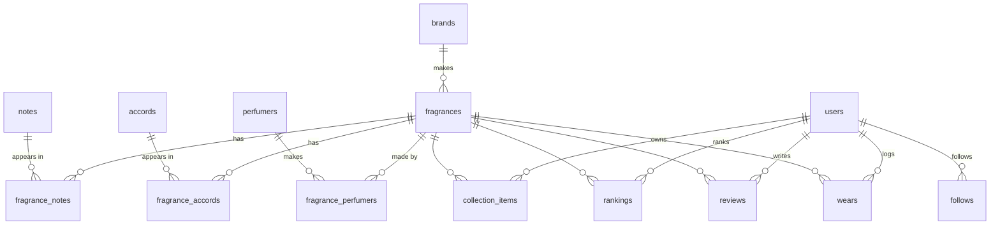

# Scentbook

**Letterboxd for fragrance.** Log your collection, keep a wear diary, rank what you've tried, and find what to smell like next.

🚧 In development. See [DECISIONS.md](DECISIONS.md) for the reasoning behind the stack.

## Tech stack

- **App:** Next.js 16 (App Router), React 19, TypeScript, Tailwind CSS
- **Database:** PostgreSQL + Drizzle ORM (pgvector for similarity search, coming soon)
- **Cloud (coming soon):** AWS RDS, S3, Lambda, CloudFront, Bedrock, Amplify, defined in AWS CDK

## Data model



## Running locally

1. Install [Postgres.app](https://postgresapp.com), open it, and click **Initialize**.
2. Create the database: in Postgres.app, double-click any database to open a terminal, then run `CREATE DATABASE scentbook;`
3. Copy `.env.example` to `.env.local` and set your Mac username.
4. Then:

```bash
npm install
npm run db:migrate
npm run db:seed
npm run dev
```

Open http://localhost:3000.

| Script | What it does |
|---|---|
| `npm run db:generate` | Turns changes in `src/db/schema.ts` into a new SQL migration in `drizzle/` |
| `npm run db:migrate` | Applies pending migrations to the database |
| `npm run db:studio` | Opens a browser UI for viewing and editing the data |
| `npm run db:seed` | Loads the hand-curated catalog in `src/db/seed/data.ts`; safe to re-run |
| `npm run fragella -- usage` | Shows how many Fragella API requests are left this month (free) |
| `npm run fragella -- fetch "<Brand>"` | Downloads up to 20 of a brand's fragrances into `.fragella/` (1 request per brand) |
| `npm run fragella -- load` | Imports everything in `.fragella/` into the database; safe to re-run, costs no requests |
| `npm run fragella -- remove` | Deletes every imported fragrance, leaving curated ones |
