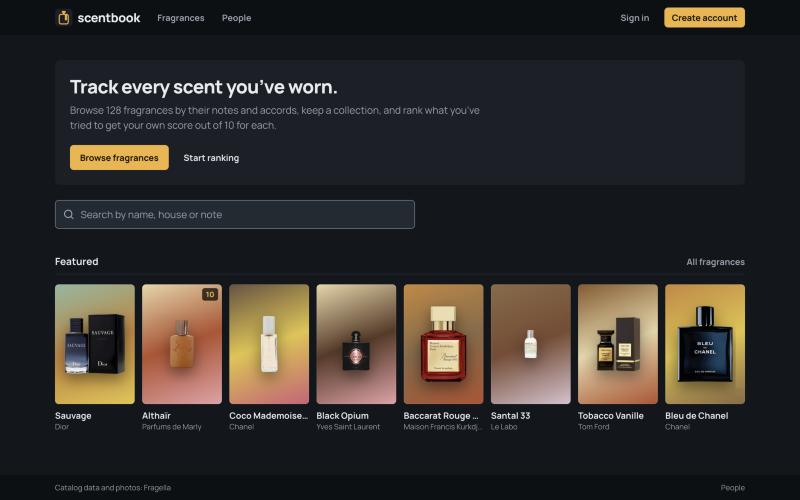
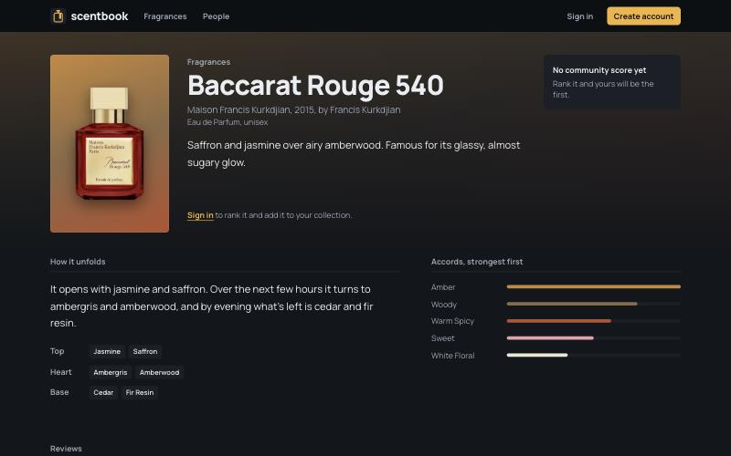
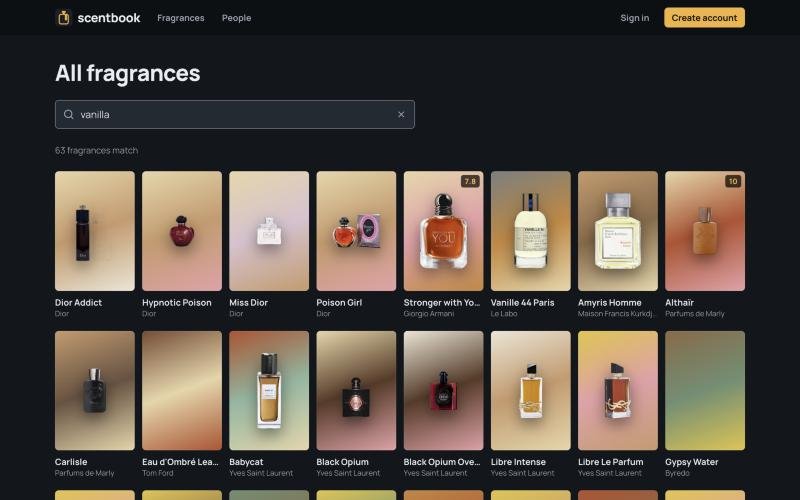
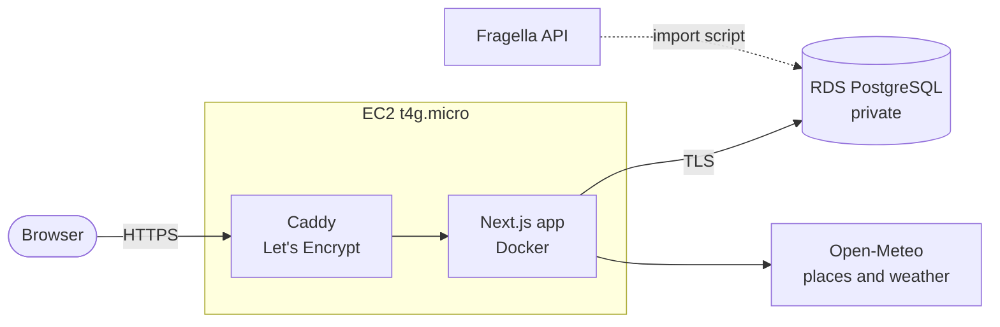
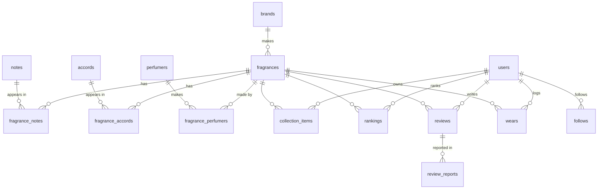

# Scentbook

**Letterboxd for fragrance.** Keep a collection, log what you wear and the weather you wore it in, rank everything you've tried into your own score out of 10, and follow other people's taste.

**Live at [scentbook.online](https://scentbook.online)**



<table>
  <tr>
    <td></td>
    <td></td>
  </tr>
</table>

## What it does

- **Browse and search** 128 fragrances from 11 houses, with their note pyramids (top, heart, base) and accords. Search filters as you type, across names, houses, notes and accords.
- **Rank what you've tried.** Say whether you loved it, thought it was fine, or didn't like it, then answer a few "which do you prefer?" questions. Your list becomes a score out of 10 for each fragrance, and everyone's scores add up to a community score.
- **Keep a wear diary.** Log each wear with the occasion, compliments and a note. The weather and temperature for that day and place fill themselves in, in °C or °F.
- **Collection, reviews and profiles.** Mark what you have, want or had; review with longevity and projection ratings; follow people and see their activity in a feed.
- **What to wear today:** a pick from your own shelf for today's weather in your city.
- **Moderation:** members report abusive reviews, three reports hide one until a moderator decides, and moderators can add missing fragrances through a form that matches every note, accord and house to the existing catalog.

## How it's built

| | |
|---|---|
| **App** | Next.js 16 (App Router, Cache Components), React 19, TypeScript, Tailwind CSS 4 |
| **Data** | PostgreSQL with Drizzle ORM: 21 tables, 7 migrations |
| **Auth** | Better Auth: email and password, GitHub and Google, with database-backed sign-in rate limits |
| **Hosting** | AWS: an EC2 server running the app in Docker behind Caddy (automatic HTTPS), Amazon RDS for the database in a private network, ECR for images, Parameter Store for secrets |
| **APIs** | Fragella (catalog import), Open-Meteo (place search, current and historical weather) |
| **Tests** | 107 unit tests on the logic that matters: ranking, scores, search, validation, matching, units |



### Things worth a look

- **Ranking by comparison, not by star rating** ([`src/lib/ranking.ts`](src/lib/ranking.ts)). A new fragrance is placed by binary search over your list, so 100 fragrances take at most 7 questions. Positions are fractional sort keys, so an insert rewrites one row, not the list. Scores come from position within loved, fine and disliked bands that never overlap.
- **Caching that stays correct** ([DECISIONS 014, 017](DECISIONS.md)). Catalog pages are prerendered and cached, and writes expire exactly the tags they affect. While testing moderation I found a case where a restored review served a stale page shell for one request. I traced it to the review list being baked into the prerendered shell, and moved it to a per-request stream backed by the same cache.
- **Search with no server round trip** ([`src/lib/search.ts`](src/lib/search.ts)). The first keystroke loads a compact index of the catalog; every keystroke after that is filtered and ranked in the browser.
- **Weather from the real place and day.** Cities are chosen from Open-Meteo's own place list and re-checked by ID on the server. A wear's weather comes from the forecast service for recent days and from the historical archive before that.
- **Moderation and abuse limits** ([DECISIONS 017](DECISIONS.md)). Report, auto-hide and review, with per-account posting limits held in Postgres under a row lock, so two requests at once can't both slip through.
- **Deploys that roll themselves back** ([DEPLOY.md](DEPLOY.md)). `scripts/deploy.sh` builds the image, pushes it, and switches the server over through Systems Manager (no SSH port). If `/api/health` doesn't pass, the old container goes back.
- **Every decision written down.** [DECISIONS.md](DECISIONS.md) has 20 records of what was picked, what else was considered, and why. [PERFORMANCE.md](PERFORMANCE.md) has the Lighthouse runs.

### Performance

Lighthouse, mobile, median of three runs ([PERFORMANCE.md](PERFORMANCE.md)):

| Page | Performance | Accessibility | Largest paint | Layout shift |
|---|---|---|---|---|
| Home | 99 | 100 | 2.2 s | 0 |
| Fragrance page | 98 | 100 | 2.3 s | 0 |
| Browse | 93 | 100 | 3.2 s | 0 |

Browse started at 83, with a 4.7 s largest paint. Loading the first two rows of bottle photos eagerly and halving the page size brought it to 93. The rest is full-size bottle photos from the catalog's image host, kept as they are on purpose ([DECISIONS 009](DECISIONS.md)).

## Data model

The core of 21 tables (accounts, moderation and rate limits are left out here):



## Running it locally

1. Install [Postgres.app](https://postgresapp.com), open it, and click **Initialize**. Then create the database: double-click any database to open a terminal and run `CREATE DATABASE scentbook;`
2. Copy `.env.example` to `.env.local`, set your Mac username in `DATABASE_URL`, and set `BETTER_AUTH_SECRET` (`openssl rand -base64 32`).
3. Then:

```bash
npm install
npm run db:migrate
npm run db:seed
npm run dev
```

Open http://localhost:3000 and create an account. To make yourself a moderator: `npm run make-admin -- <your-username>`.

<details>
<summary>GitHub and Google sign-in (optional)</summary>

The "Continue with GitHub/Google" buttons appear once their keys are in `.env.local`. Restart `npm run dev` after adding them.

- **GitHub:** Settings → Developer settings → OAuth Apps → New OAuth App. Homepage URL `http://localhost:3000`, callback URL `http://localhost:3000/api/auth/callback/github`. Put the client ID and a new secret in `GITHUB_CLIENT_ID` and `GITHUB_CLIENT_SECRET`.
- **Google:** Google Cloud Console → APIs & Services → Credentials → Create credentials → OAuth client ID (Web application). Origin `http://localhost:3000`, redirect URI `http://localhost:3000/api/auth/callback/google`. Put them in `GOOGLE_CLIENT_ID` and `GOOGLE_CLIENT_SECRET`.

</details>

<details>
<summary>Scripts</summary>

| Script | What it does |
|---|---|
| `npm run dev` | Development server |
| `npm test` | Unit tests |
| `npm run db:generate` | Turns changes in `src/db/schema.ts` into a new migration in `drizzle/` |
| `npm run db:migrate` | Applies pending migrations |
| `npm run db:studio` | A browser UI for the data |
| `npm run db:seed` | Loads the hand-curated catalog in `src/db/seed/data.ts`; safe to re-run |
| `npm run make-admin -- <username>` | Makes someone a moderator (`--remove` to undo) |
| `npm run fragella -- usage` | Fragella API requests left this month |
| `npm run fragella -- fetch "<Brand>"` | Downloads a house's 20 most popular fragrances into `.fragella/` (2 requests) |
| `npm run fragella -- load` | Imports everything in `.fragella/`; safe to re-run, costs no requests |
| `npm run fragella -- remove` | Deletes every imported fragrance, leaving curated ones |
| `scripts/deploy.sh` | Builds and deploys to production (`--rollback` to undo); see [DEPLOY.md](DEPLOY.md) |

</details>

## Credits

Fragrance data and bottle photos from the [Fragella API](https://api.fragella.com). Weather and places from [Open-Meteo](https://open-meteo.com). Built by [Guteraa Ayana](https://github.com/GuteraaAyana).
